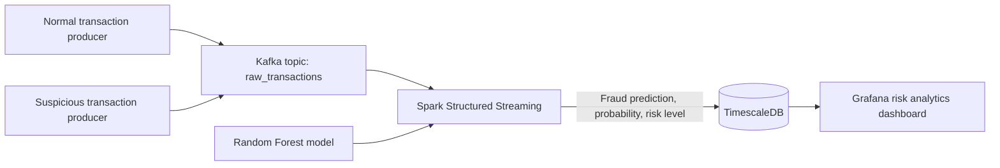

# UPIGuard — Real-Time UPI Fraud Detection & Risk Analytics

UPIGuard is an educational real-time fraud-monitoring pipeline built around synthetic UPI-style transactions. Normal and suspicious transaction producers publish events to Kafka. Spark Structured Streaming consumes the events, scores them with a Random Forest model, and writes the predictions and risk levels to TimescaleDB. Grafana provides a provisioned risk analytics dashboard.

> **Important:** The project uses synthetic data only. It is a learning/portfolio demonstration, not a production fraud-decisioning system and not connected to NPCI, banks, UPI apps, or real customer data.

## Architecture



## Features

- Two independent Kafka producers for normal and suspicious UPI-style transactions.
- Kafka topic `raw_transactions` for event ingestion.
- Spark Structured Streaming micro-batches with a pre-trained/rebuilt Random Forest model.
- Fraud probability and risk bands: `LOW` below 0.30, `MEDIUM` from 0.30 to below 0.70, and `HIGH` at or above 0.70.
- TimescaleDB storage with idempotency using Kafka partition/offset metadata.
- Grafana data source and 10-panel dashboard provisioned automatically.
- Reproducible synthetic training data generation and model training.

## Dashboard panels

1. Total Transactions
2. Fraudulent Transactions
3. Fraud Rate (%)
4. High Risk Transactions
5. Total Transaction Value (₹)
6. Live Transaction Activity
7. Fraud Trend Over Time
8. Fraud by City
9. Risk Distribution
10. Recent Transactions

The dashboard is provisioned from `monitoring/grafana/dashboards/upiguard-risk-analytics.json`. Grafana refreshes every five seconds and opens on a 30-day time range.

## Technology stack

| Component | Technology |
|---|---|
| Event producers | Python, kafka-python |
| Message broker | Apache Kafka (Confluent Platform image) + ZooKeeper |
| Stream processing | Apache Spark 3.5.2 Structured Streaming |
| ML model | scikit-learn Random Forest |
| Time-series storage | TimescaleDB / PostgreSQL 14 |
| Visualization | Grafana 11.2 |
| Runtime | Docker Compose |

## Prerequisites

- Docker Desktop with the Docker Compose plugin
- At least 8 GB RAM recommended for a local demo (more is helpful)
- Git

## Run locally

### 1. Clone the repository

```bash
git clone https://github.com/aryannn45/UPIGuard.git
cd UPIGuard
```

### 2. Configure local credentials

Copy `.env.example` to `.env` and change both passwords:

**PowerShell**

```powershell
Copy-Item .env.example .env
notepad .env
```

**macOS/Linux**

```bash
cp .env.example .env
nano .env
```

Do not commit `.env`. The `.gitignore` excludes it.

### 3. Start the stack

```bash
docker compose up --build -d
```

The stack starts ZooKeeper, Kafka, the normal and suspicious producers, a Spark master/worker, TimescaleDB, model training, the Spark streaming application, and Grafana. The model-training service creates `model_build/fraud_detection_model.pkl` using the pinned scikit-learn version before the streaming job starts.

### 4. Check service status

```bash
docker compose ps
```

Follow producer logs:

```bash
docker compose logs -f producer hacker-producer
```

Follow the Spark scoring pipeline:

```bash
docker compose logs -f spark-streaming
```

The Spark job prints batch counts, inserted rows, fraud predictions and high-risk counts.

### 5. Open the dashboard

- Grafana: <http://localhost:3000>
- Spark master UI: <http://localhost:8080>
- Spark worker UI: <http://localhost:8081>
- Spark application UI (while the stream is running): <http://localhost:4040>

Use the Grafana username/password configured in `.env` (`GRAFANA_ADMIN_USER` and `GRAFANA_ADMIN_PASSWORD`). The `UPIGuard` folder and dashboard should appear automatically. The PostgreSQL data source is also provisioned automatically; there is no need to add it manually.

### 6. Query TimescaleDB manually

```bash
docker compose exec timescaledb psql -U user -d fraud_detection -c "SELECT COUNT(*) FROM transactions;"
```

If you changed `POSTGRES_USER` or `POSTGRES_DB` in `.env`, substitute those values in the command.

## Train the model manually

The normal stack runs the `model-trainer` service automatically. To regenerate the training CSV and model manually:

```bash
cd model_build
python -m venv .venv
# Activate the environment, then:
pip install -r requirements.txt
python training_data_generation.py --rows 10000 --fraud-rate 0.03 --seed 42
python ml_model.py
```

The training script writes `fraud_detection_model.pkl` and `metrics.json`. These generated artifacts are ignored by Git. The same pinned scikit-learn version is used in the model trainer and Spark image to avoid model-persistence version mismatch warnings.

## Stop the stack

```bash
docker compose down
```

This keeps named volumes. To delete the database, Grafana state and Spark checkpoint data permanently, use `docker compose down -v` only when you intentionally want a clean reset.

## Troubleshooting

### Producers exit or do not send messages

```bash
docker compose ps -a producer hacker-producer
docker compose logs --tail=100 broker producer hacker-producer
```

Check that the Kafka broker is healthy and that the topic name is `raw_transactions`.

### Spark cannot find the model

```bash
docker compose logs model-trainer
docker compose logs --tail=100 spark-streaming
```

The model trainer must finish successfully before `spark-streaming` starts. Confirm that `model_build/synthetic_fraud_data.csv` exists and is readable.

### Grafana shows no data

Confirm the stream is inserting rows:

```bash
docker compose exec timescaledb psql -U user -d fraud_detection -c "SELECT transaction_id, transaction_time, fraud_prediction, risk_level FROM transactions ORDER BY transaction_time DESC LIMIT 10;"
```

The producers use the container's system clock in UTC. If the displayed transaction time is unexpected, verify the host computer's date/time and time-zone settings. In Grafana, use a time range that includes the timestamps in the database.

### Rebuild a single service

```bash
docker compose build producer hacker-producer spark-streaming
docker compose up -d producer hacker-producer spark-streaming
```

## Repository layout

```text
UPIGuard/
├── data_producer/
│   ├── Dockerfile
│   ├── requirements.txt
│   ├── normal_transaction_producer.py
│   └── hacker_transaction_producer.py
├── data_processor/
│   ├── Dockerfile.spark
│   ├── requirements.txt
│   └── fraud_detector.py
├── model_build/
│   ├── Dockerfile
│   ├── requirements.txt
│   ├── training_data_generation.py
│   └── ml_model.py
├── monitoring/
│   ├── init.sql
│   └── grafana/
│       ├── Dockerfile
│       ├── dashboards/upiguard-risk-analytics.json
│       └── provisioning/
├── docs/
│   ├── images/
│   └── reference/
├── tests/
├── .env.example
├── .gitignore
├── docker-compose.yml
├── LICENSE
├── NOTICE.md
└── README.md
```

## Data and model limitations

- Events, account IDs, amounts, cities and fraud labels are simulated.
- The training set is generated with deliberately separable synthetic patterns so the demo can exercise both legitimate and suspicious event paths. Metrics from this artificial dataset are not representative of performance on real payment traffic.
- A holdout score on synthetic data is not evidence of real-world fraud detection accuracy.
- The risk-level thresholds are demo configuration, not bank policy or a recommendation for live transactions.
- Before production use, the project would need representative authorized data, privacy/security controls, model calibration, drift monitoring, human review, load testing and independent security review.

## Publish to GitHub

See [`UPLOAD_TO_GITHUB.md`](UPLOAD_TO_GITHUB.md) for the review-first publishing steps. Do not create the remote repository, commit, or push until the staged file list has been reviewed and approved.

## Attribution

This work is inspired by [`iitravindra/streaming_fraud_detection`](https://github.com/iitravindra/streaming_fraud_detection). The original MIT license and attribution are preserved. See [`NOTICE.md`](NOTICE.md) for a summary of the modifications made for the UPIGuard UPI-style demo.
